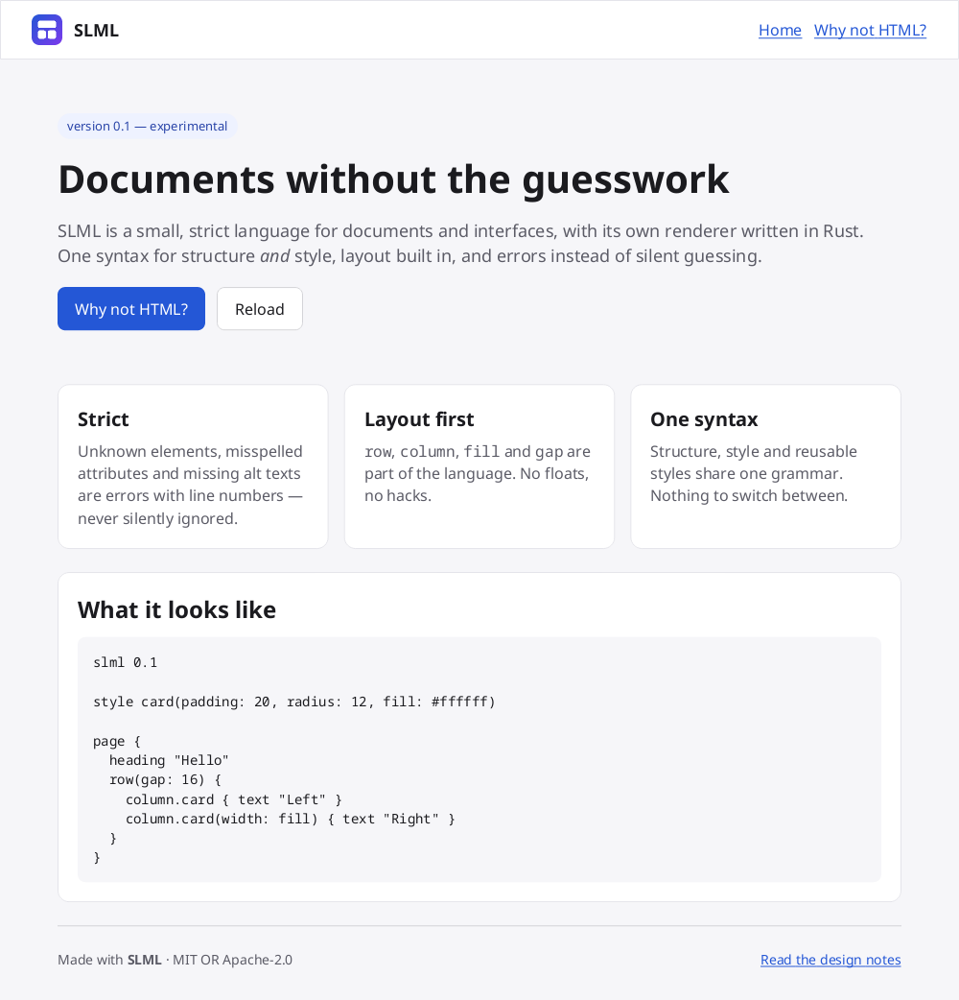

# SLML

**SLML — Strict Layout Markup Language.** A strict, layout-first alternative to HTML, with its own renderer written in Rust.

> 🇵🇱 [Polska wersja](README.pl.md)

```slml
slml 0.1

style card(padding: 20, radius: 12, fill: #ffffff, width: fill)

page(fill: #f6f6f9) {
  heading "Hello, SLML!"
  row(gap: 16) {
    column.card { text { "Layout is " bold "built in" "." } }
    column.card { text { link(to: "about.slml") "Why not HTML?" } }
  }
  image(src: "logo.png", alt: "SLML logo", width: 64)
}
```



## Why?

HTML has been extended for thirty years without breaking old pages, and it
shows. SLML starts over and keeps the good parts (a tree of elements, links,
text) without the historical accidents:

| HTML | SLML |
|------|------|
| Broken markup is silently "repaired" | Invalid documents are **rejected with a precise error and a hint** |
| HTML + CSS + JS: three syntaxes, selectors, cascade | **One grammar** for structure and style |
| Layout added later (floats → flexbox → grid) | `row`, `column`, `gap`, `fill`, `align` from day one |
| Whitespace collapsing, `&amp;`, optional closing tags, quirks mode | Quoted literal text, `{ }` blocks, a version line |
| `` without `alt` is valid | `image` **requires** `alt` |
| Rendering depends on installed fonts and browser defaults | Fonts bundled, every default written in the spec |

Read more in [docs/principles.md](docs/principles.md) and the full
[language spec](SPEC.md).

## Install and use

`slml` is a single compiler program, like `gcc`. No Rust needed to use it:

```bash
curl -fsSL https://raw.githubusercontent.com/KubeKoslaw/slml/main/install.sh | sh
```

Or from source: `make install` (needs Rust 1.88+). Then:

```bash
slml page.slml                 # → page.html (+ _slml/ styles and fonts)
slml site/ -o public/          # build a whole website
slml serve site/ --open        # live preview in your browser
slml check site/               # only report errors
slml view page.slml            # native SLML viewer (own renderer)
```

**Read the [handbook](handbook/)**, which is itself written in SLML: `slml serve handbook --open`.

When something is wrong, SLML tells you exactly what and where:

```text
error: unknown element `colum`
 --> page.slml:3:3
  |
3 |   colum {
  |   ^^^^^
  = hint: did you mean `column`?

error: `image` requires `alt`
 --> page.slml:5:5
  |
5 |     image(src: "cat.png")
  |     ^^^^^
  = hint: describe the image for people who cannot see it; use `alt: ""` only for decoration
```

## Project layout

```
crates/
  slml-syntax/   lexer → parser → validator → typed model (no dependencies)
  slml-render/   layout engine + CPU renderer (fontdue, tiny-skia)
  slml-html/     HTML+CSS backend (no JavaScript in output)
  slml-cli/      the `slml` compiler: compile, build sites, serve, check, view
examples/        sample documents (every one is tested in CI)
handbook/        the user guide, written in SLML
SPEC.md          the language specification: the source of truth
ROADMAP.md       what comes next
AGENTS.md        instructions for AI coding agents
```

## Contributing

Humans and AI agents are both welcome. Start with
[CONTRIBUTING.md](CONTRIBUTING.md). AI agents should read
[AGENTS.md](AGENTS.md). Good first tasks are marked in
[ROADMAP.md](ROADMAP.md).

## License

Code: MIT or Apache-2.0, at your option. Bundled Noto fonts: SIL Open Font
License 1.1 (see `assets/fonts/OFL.txt`).
